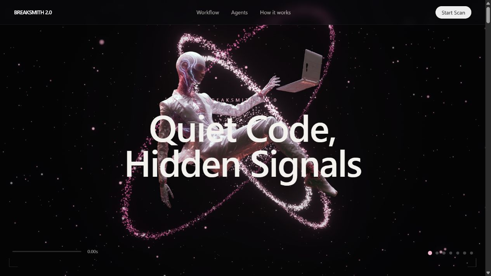
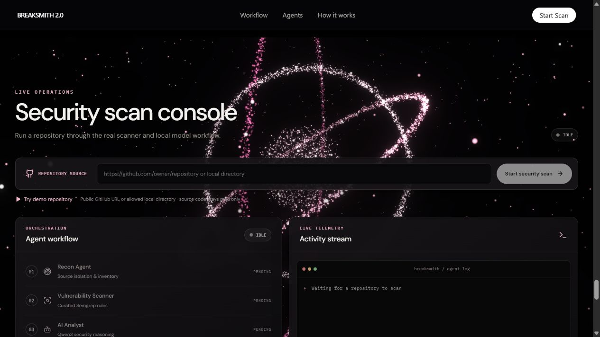
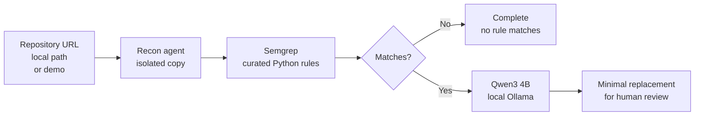

<div align="center">
  
  <h1>BreakSmith 2.0</h1>
  <p><strong>Quiet code. Hidden signals. A security workflow you can actually inspect.</strong></p>
  <p>
    <a href="#how-it-works"></a>
    <a href="backend/rules/python-security.yml"></a>
    <a href="#the-local-stack"></a>
    <a href="LICENSE"></a>
  </p>
  <p>
    <a href="#how-it-works">Explore the workflow</a> ·
    <a href="#run-it-locally">Run the demo</a> ·
    <a href="docs/DESIGN.md">See the design system</a> ·
    <a href="docs/API.md">Read the API</a>
  </p>
</div>

<br />



> **One repository in. Evidence, reasoning, and a reviewable fix out.** BreakSmith scans real Python source with curated Semgrep rules, sends up to three findings to a locally installed Qwen3 4B model through Ollama, and displays a minimal suggested replacement. The original repository is never patched.

## Why it exists

Security tools can produce a wall of alerts without showing what happened between source code and recommendation. BreakSmith makes each step visible: the isolated source copy, the scanner match, the model's analysis, and the proposed code. It is a local-first hackathon project built for **human review**, not automatic approval.

| | What you get | What it means |
| :---: | --- | --- |
| 🛰️ | **Recon with boundaries** | Public GitHub repositories, allowed local directories, or the included demo are copied to a temporary workspace. Repository code is not executed. |
| 🛡️ | **Scanner evidence** | Semgrep reports the rule, severity, file, line, and surrounding source for each match. |
| ✦ | **Local model analysis** | Qwen3 4B explains selected findings through Ollama. No cloud model key is required. |
| ⟐ | **Reviewable repair** | The original and suggested code appear together. BreakSmith does not apply the suggestion. |
| ◉ | **Live operations view** | The console polls real job state and events, including dependency and model failures. |



## How it works



The backend moves through `IDLE → CLONING → SCANNING → ANALYZING → GENERATING_FIX → COMPLETE`. Failures enter `FAILED`; model errors stay attached to the affected finding and appear in the activity stream. The frontend polls the job, so the page remains responsive while scanning and inference continue.

### The agents, precisely

| Stage | Does | Does not |
| --- | --- | --- |
| **Recon Agent** | Validates the source and creates a disposable copy of supported Python files | Execute repository code |
| **Vulnerability Scanner** | Runs [curated Semgrep rules](backend/rules/python-security.yml) for SQL string construction, shell invocation, and hardcoded example credentials | Certify that an unmatched repository is secure |
| **AI Analyst** | Requests structured category, impact, risk, remediation, and uncertainty for up to three findings | Invent a finding when Semgrep reports none |
| **Remediation Agent** | Requests one minimal code replacement and checks that its original excerpt matches the source | Apply or verify a patch automatically |

Select a different finding in the console and use **Analyze & propose fix** to investigate it after the initial run.

## Run it locally

**Prerequisites:** Python 3.13, Node.js 20+, Git, [Ollama](https://ollama.com/), and the `qwen3:4b` model installed locally. The app does not download a model for you. Ollama should be running before the backend starts.

```powershell
# Once, if the model is not already installed:
ollama pull qwen3:4b

# Terminal 1 — from the project root:
python -m venv .venv
.\.venv\Scripts\Activate.ps1
python -m pip install -r backend\requirements.txt
python -m uvicorn backend.main:app --host 127.0.0.1 --port 8000
```

```powershell
# Terminal 2 — from the project root:
cd frontend
npm ci
npm run dev
```

Open **[http://127.0.0.1:5173](http://127.0.0.1:5173)**, choose **Start Scan**, then **Try demo repository**. The intentionally vulnerable [sample](demo-repository/) goes through the same scanner and model workflow as any other source. There are no hardcoded demo findings.

Check **[http://127.0.0.1:8000/api/health](http://127.0.0.1:8000/api/health)** if a dependency appears offline. `ollama list` should include `qwen3:4b`, and the health response should report Semgrep as available.

<details>
<summary><strong>Use a public GitHub repository or local source directory</strong></summary>

Paste a public `https://github.com/owner/repo` URL into the console. Remote clones are read-only and use no interactive credentials. For a local directory outside this project, set `BREAKSMITH_LOCAL_ROOTS` before starting the backend:

```powershell
$env:BREAKSMITH_LOCAL_ROOTS = 'C:\path\to\allowed\projects'
```

On Windows, separate multiple roots with semicolons. The default permits only this project directory. Only Python files are copied for the current ruleset.
</details>

<details>
<summary><strong>Windows scanner troubleshooting</strong></summary>

Semgrep's native engine may report a `socketpair` system-call error inside restricted terminals. Start the backend in a normal local PowerShell window and keep it bound to `127.0.0.1`. The current backend has no authentication.
</details>

## The local stack

| Layer | Technology | Role |
| --- | --- | --- |
| Interface | React 19, Vite 6, TypeScript | Scan form, live events, finding review, and code comparison |
| Visual experience | Supplied cinematic HTML, Three.js, GSAP, Tailwind utilities, Iconify, Lucide | Orbital background, scroll sequence, parallax, cards, and iconography |
| API | FastAPI | Source validation, background jobs, state, and results |
| Scanner | Semgrep | Curated static matches in Python source |
| Local inference | Ollama + `qwen3:4b` | Structured analysis and proposed replacement |

The five photographic visuals and browser animation scripts are checked into `frontend/public`, so the landing design no longer depends on the original image host or CDNs. See the [design language](docs/DESIGN.md) for palette, typography, icons, and motion.

## Configuration

These optional variables belong to the backend process. See [`.env.example`](.env.example) for a starting list; the app reads environment variables rather than loading that file automatically.

| Variable | Default | Purpose |
| --- | --- | --- |
| `BREAKSMITH_MODEL` | `qwen3:4b` | Ollama model name |
| `BREAKSMITH_OLLAMA_URL` | `http://localhost:11434` | Local Ollama endpoint |
| `BREAKSMITH_INFERENCE_TIMEOUT` | `180` | Seconds allowed for each model request |
| `BREAKSMITH_THINK` | `false` | Enable Qwen3 thinking responses |
| `BREAKSMITH_LOCAL_ROOTS` | Project root | Allowed local source roots, separated by the OS path separator |

Model requests are serialized. The backend allows at most two active scans and caps copied Python source at 3,000 files or 30 MB. A large remote repository may still consume clone bandwidth before those copy limits are checked.

## API at a glance

| Method | Endpoint | Result |
| --- | --- | --- |
| `GET` | `/api/health` | Backend, Ollama model, and Semgrep status |
| `POST` | `/api/scans` | Start a job with `{"source":"demo"}`, a GitHub URL, or an allowed path |
| `GET` | `/api/scans/{id}` | State, events, metrics, findings, and summary |
| `POST` | `/api/scans/{id}/findings/{finding_id}/investigate` | Investigate one selected finding after completion |

The [API reference](docs/API.md) includes PowerShell requests. The [architecture notes](docs/ARCHITECTURE.md) cover source boundaries, job states, and trust boundaries.

## Boundaries worth knowing

BreakSmith is a **hackathon MVP, not a security certification tool**. Its initial rules cover a few Python patterns. Matches can be false positives, and no match does not prove safety. AI analysis and suggested code can be wrong. Always review and test a proposed change before using it.

The app never executes repository code or AI-generated commands, skips symlinks and common generated directories, and does not write fixes. Jobs and events live in process memory and disappear when the backend restarts. The API is unauthenticated, so run it on loopback only.

## Project map

```text
backend/                 FastAPI orchestrator and Semgrep rules
demo-repository/         Deliberately vulnerable Python sample
frontend/                Cinematic page, React scan console, bundled assets
docs/                    Design, architecture, API, and README artwork
```

MIT licensed. Good next contributions include carefully scoped rules, stronger model-response validation, more language coverage, and better verification of suggested fixes.
# BreakSmith-2.0
# BreakSmith-2.0
