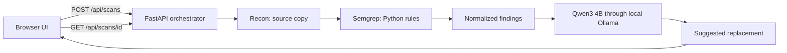
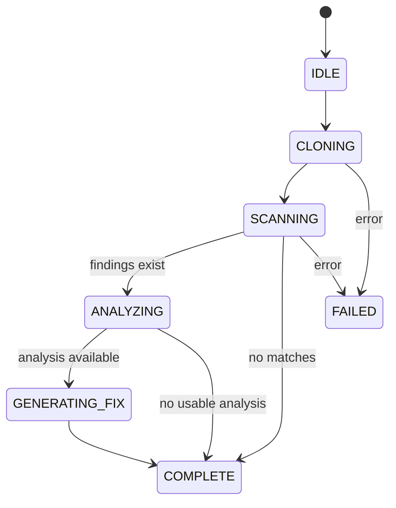

# Architecture

BreakSmith is a local web application with a React/Vite presentation layer and a FastAPI orchestrator. The frontend never fabricates scan data: it creates a job, polls its state, and renders the returned events, findings, analysis, and fixes.

## Source boundary

The backend accepts the included `demo` source, a public `https://github.com/owner/repo` URL, or an allowed local directory. It clones or copies supported Python files into a temporary workspace, skips symlinks and generated folders, and caps the copy at 3,000 files or 30 MB of source. It does not run repository code. Git credentials and hooks are disabled for remote clones.

Local directory access is restricted to `BREAKSMITH_LOCAL_ROOTS`. The default root is this project directory. The backend binds to loopback in the documented run command because it has no authentication.

## Job lifecycle

The initial workflow analyzes up to three findings in sequence. A selected finding can be investigated later with `POST /api/scans/{id}/findings/{finding_id}/investigate`. Model requests are serialized. A failed model call is recorded on that finding and in the event stream; it is not treated as a successful analysis.

## Trust boundaries

| Boundary | Current behavior |
| --- | --- |
| Repository input | Read-only source copy; repository code is not executed |
| Scanner output | Semgrep matches normalized with rule ID, severity, path, line, and snippet |
| Model output | JSON response checked for required fields; a proposed replacement must match the source excerpt |
| Source modification | No patch application; user reviews suggested code manually |
| Persistence | In-memory jobs and events; backend restart clears them |

See the [API reference](API.md) for endpoint shapes and the [design guide](DESIGN.md) for how these states appear in the UI.
